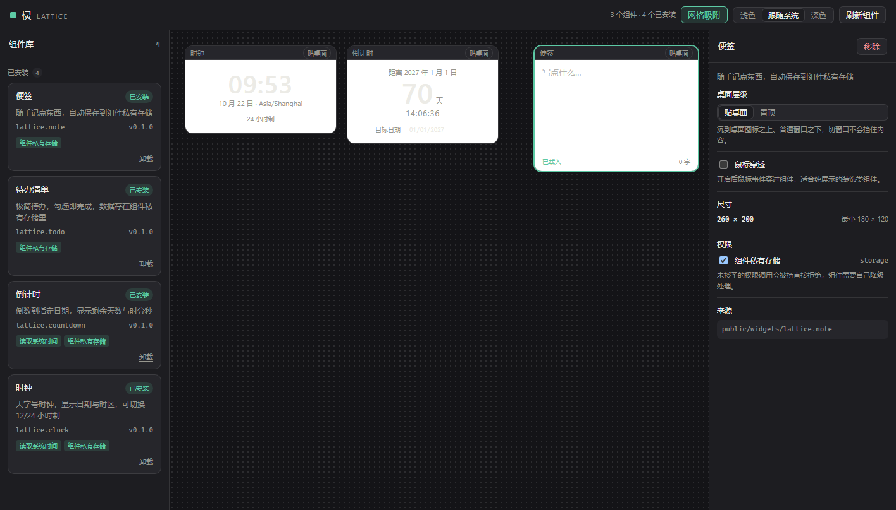

# 棂 · Lattice

可扩展的 Windows 桌面小组件平台。第三方用 HTML / CSS / JS 写组件，平台负责把它们安全地放到桌面上。

> 棂（líng）是窗格上的木格。桌面上的每一个格子，都是一个可以自己长出来的小组件。

## 现状

v0.1 是**可运行的 demo**：平台开箱是空白的，安装官方组件包后把组件摆到画布上，组件在沙箱 iframe 里真实运行，通过 RPC 桥调用平台能力，权限逐项授予。



还没做的：把画布上的组件变成真正的独立桌面窗口（见 [ROADMAP](./docs/ROADMAP.md)）。

## 平台是空白的

装好第一次打开，桌面上什么都没有——像刚装好的 VS Code 没有插件。

- **核心不含任何组件**：画布、窗口层、组件宿主、权限系统、安装卸载、组件库、设置
- **官方组件没有特权**：`public/widgets` 下的包走和第三方完全相同的 manifest、沙箱、权限桥，只是"已经在你硬盘上"，不是"编译进了内核"
- **发现 ≠ 安装**：`bundled` 来源必须显式安装；`user` 来源（`%APPDATA%` 下的包）在磁盘上就算已装

这条原则的完整论述见 [ARCHITECTURE](./docs/ARCHITECTURE.md#零内置原则)。

## 权限是看得见的

组件撞到未授权的能力时，画布上直接弹出提示，一次授予全部所需权限，组件随即重新初始化：


沙箱 iframe **不含 `allow-same-origin`**，所以组件拿到的是不透明源：读不到宿主 DOM、没有可用的 `localStorage`、发出的请求带 `Origin: null`。它除了走桥，什么都做不了。桥的鉴权用 `event.source` 比对窗口引用而非 `event.origin`——沙箱 iframe 的 origin 都是字符串 `"null"`，靠它区分不出实例。

## 技术栈

| 层 | 选型 | 为什么 |
| --- | --- | --- |
| 外壳 / 窗口 | Tauri 2 + `windows-sys` | 常驻应用对内存敏感；Win32 行为要直调 |
| UI | React 19 + TypeScript | 与组件生态一致 |
| 构建 | Vite 8 | 快，且与 Tauri 官方模板对齐 |
| 状态 | Zustand（带 persist） | 平台状态很浅，不需要更重的东西 |
| 样式 | 纯 CSS + CSS 变量 | 定制工作台，变量层比工具类更可控 |
| 组件运行时 | 沙箱 iframe + postMessage RPC | 见 [ARCHITECTURE](./docs/ARCHITECTURE.md) |

## 快速开始

```bash
npm install
npm run dev           # 浏览器里跑 demo：http://localhost:1420
npm run tauri:dev     # 完整桌面应用（首次要编译 Rust）
npm run tauri:build   # 出安装包：src-tauri/target/release/bundle/nsis
```

环境要求：Node ≥ 20、Rust 工具链、WebView2（Win11 自带）。

> 只想看 demo 的话用 `npm run dev`，不需要 Rust。桌面端目前需要 `windres`（mingw binutils）或 MSVC 工具链，见 ROADMAP 的环境说明。

## 目录

```
src/
  platform/          平台外壳：画布、组件库、属性面板、平台状态
  runtime/           组件运行时：manifest 校验、注册表、RPC 桥
public/widgets/      官方组件包（未安装前只是"可安装"）
scripts/             构建辅助（生成组件索引）
src-tauri/
  src/widgets.rs     组件包扫描 / 安装 / 卸载
  src/desktop.rs     窗口层级、鼠标穿透、焦点行为（Win32）
docs/
  ARCHITECTURE.md    架构与取舍
  WIDGET_SPEC.md     组件规范（写组件看这个）
  ROADMAP.md         路线图与已知缺口
```

## 写一个组件

```
public/widgets/lattice.hello/
  manifest.json
  index.html
  widget.js
```

```json
{
  "id": "lattice.hello",
  "name": "你好",
  "version": "0.1.0",
  "entry": "index.html",
  "size": { "w": 200, "h": 100, "minW": 120, "minH": 60 },
  "layer": "desktop",
  "permissions": ["clock"]
}
```

组件里用 `parent.postMessage({ __lattice: 1, type: "request", id, method, params }, "*")` 调平台能力，完整协议见 [WIDGET_SPEC](./docs/WIDGET_SPEC.md)。改完执行 `npm run widgets:index` 让平台发现新组件。

## 许可

MIT
