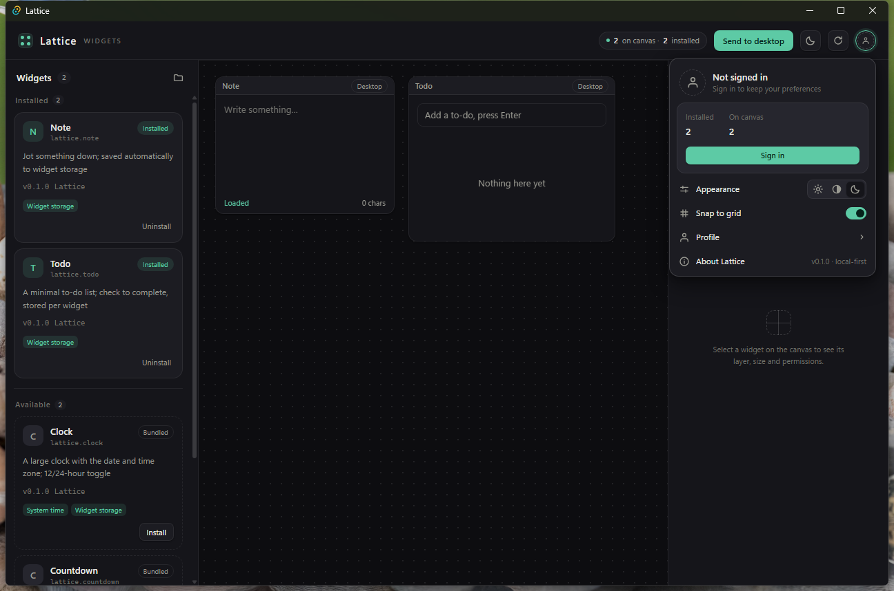
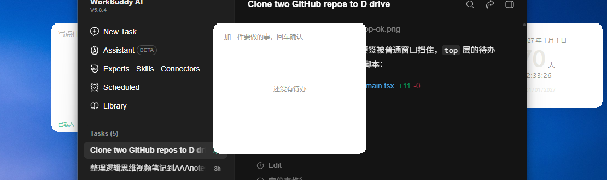
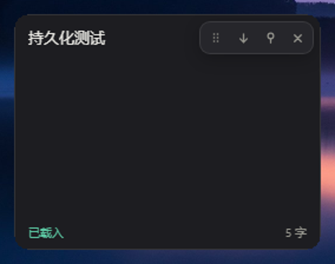
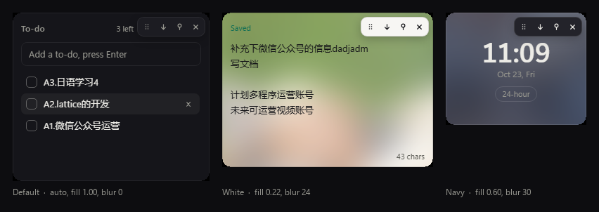
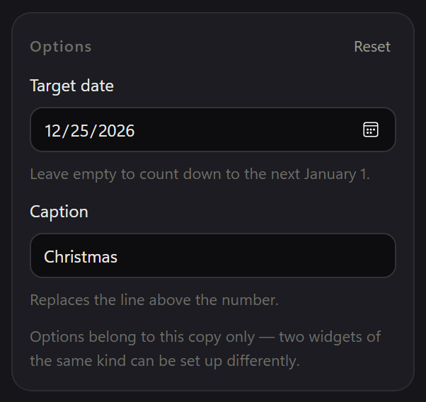
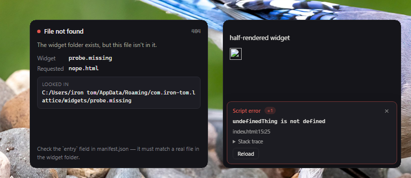
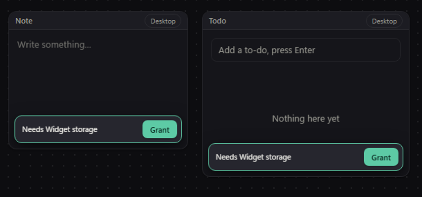

# 棂 · Lattice

[](https://github.com/unraveltao/lattice/actions/workflows/ci.yml)

[English](./README.md) · 中文

可扩展的 Windows 桌面小组件平台。第三方用 HTML / CSS / JS 写组件，平台负责把它们安全地放到桌面上。

> 棂（líng）是窗格上的木格。桌面上的每一个格子，都是一个可以自己长出来的小组件。

## 现状

v0.5 是**能分发**的版本：写组件、装组件、更新组件这三件事现在都有正经的路。平台开箱是空白的，安装官方组件包后把组件摆到画布上，组件在沙箱 iframe 里真实运行，通过 RPC 桥调用平台能力，权限逐项授予。点"投放到桌面"，每个组件变成一个独立的无边框窗口，主窗口最小化退场。

落到桌面上之后，窗口能拖、能缩、能用别针锁住，布局与组件数据重启不丢。顶栏右上角是设置：明暗、网格吸附、重启恢复、开机自启、暂停全部组件、本机档案——登录只写本地 `state.json`，不上传、不联网。

它也开始像一个"要一直挂着"的东西了：

- **有托盘**，主窗口收起来之后也找得到——打开、暂停全部组件、退出
- **开机自启**（写一个 `Run` 注册表项，卸载时删掉）
- **暂停全部组件**一次把桌面窗口全藏起来；心跳跟着停，不是只把画面藏了
- **渲染进程崩了自己回来**——一分钟内最多重载三次，之后不再重试，改成在底部弹一条 `Try again`
- **组件文件存盘即重载**，不用重启、不用点重载按钮

第三方组件也能用：把整个文件夹拖进窗口就装好了，文件落在 `%APPDATA%`，经 `lattice-widget` 协议加载。[`examples/counter`](./examples/counter) 是一个可以直接拖进去的样本。

两侧面板都能收成 40px 竖条，把整块画布让出来；每个组件包也可以自带图标——组件库卡片、画布标题条、属性面板画的都是它，不再是"名字首字"的色块。

v0.4 补的是**写组件那一侧**，不是用组件那一侧：

- **`@lattice/sdk`** —— 零依赖的 ES module，把桥包起来（请求配对、超时、带 `code` 的错误、主题令牌、存储、心跳）。它是一个**拷到你组件目录里的普通文件**，不是 `npm install`——"组件不用构建"这个前提保住了
- **`npm run create:widget -- demo.mine`** —— 脚手架，一次生成能跑起来的组件，连窗饰要占的那 22px 都让好了
- **`npm run pack:widget -- <目录>`** —— 把目录打成一个 `.lattice`（确定性的 zip），谁都能拖进自己窗口装上
- **媒体控制** —— 组件能读也能按 Windows 的媒体会话（SMTC）：现在在放什么、播放/暂停、上一首、下一首
- **调试面板**（`Ctrl+Shift+D`）—— 每一次桥调用（耗时、错误码）和沙箱里每一条 `console.log`，实时滚在一条抽屉里

v0.5 补的是**分发**。这个平台没有服务端，所以答案不是"搭一个商店后台"，而是"目录是一份静态 JSON，包是签名过的文件"：

- **组件商店** —— 一份 `registry.json` + 一批 `.lattice` 包。默认读线上那份官方目录（就是 GitHub Pages 上的一个静态文件），换源在设置里；随应用发的那份内置目录退成**断网兜底**，界面会写明"这是随应用带的"
- **签名是三道校验** —— 包的摘要对得上 → ed25519 签名验得过 → 那把钥匙等于**这个组件第一次安装时钉在本地的**。前两道挡损坏和伪造，第三道才挡得住"另起一把钥匙、连目录一起换掉"。换钥匙要用户点头，界面上同时印出两把指纹
- **更新与回滚** —— 覆盖安装前把旧版本备份成一代，卡片上出现 `Back to x.y.z`。回滚是**交换**不是复制，所以按钮可以按两次、两个方向都成立
- **评分与举报** —— 五颗星，加一份写在本地的报告文件。没有服务端，所以没有"提交"这回事：对话框直接告诉你文件存在哪儿，你自己发给作者
- **新权限要重新确认** —— 更新后多出来的权限不自动授予，也不禁用组件：照旧能用，底部弹一条不会自己消失的横幅，直到你点 `Allow` 或 `×`

```bash
npm run store:index                              # 打包 + 签名 + 写目录
npm run sign:widget -- --gen-key --out my.key    # 生成你自己的发布密钥
```

现在的界面（设置菜单展开）：



## 组件真的在桌面上



上图是实机截图：左边被普通窗口挡住的便签是 `layer: desktop`，中间压在窗口之上的待办是 `layer: top`，右边是倒计时。

"投放到桌面"之后：

- 每个 Placement 变成一个独立的 `WebviewWindow`，加载 `widget-host.html`，再由它套一层沙箱 iframe——**桌面窗口和画布预览跑的是同一套桥、同一套权限校验**，不会出现"预览能用、桌面上不能用"的分叉
- `layer: desktop` 的组件挂到 WorkerW（拿不到时降级 `HWND_BOTTOM`），沉在普通窗口之下；`layer: top` 的走 `HWND_TOPMOST`
- 窗口无边框、不进任务栏、`WS_EX_NOACTIVATE` 不抢焦点，形状由 `SetWindowRgn` 裁成圆角
- 画布上继续拖动、改层级，桌面窗口跟着走（120ms 防抖增量同步）

## 桌面窗口能直接摆弄



组件浮在桌面上之后，把鼠标移到它身上，右上角浮出一排功能图标——这些是**宿主页画的，不是组件画的**，组件完全不用操心自己怎么被搬动：

| 图标 | 做什么 |
| --- | --- |
| ⣿ 拖动 | 按住搬窗口。用 `setPointerCapture` 跟踪指针，拖出窗口甚至拖出屏幕都不会断线 |
| ↓ / ↑ 层级 | 在"贴桌面"与"置顶"之间切换，立刻作用到 Win32 的 z-order |
| ⚲ 别针 | 锁住位置与大小。锁上之后拖拽和八条缩放手柄整体禁用，光标也跟着变成默认箭头 |
| ✕ 收回 | 关掉这个窗口，并把 placement 从画布上删掉（不是藏起来） |

八向缩放手柄贴着窗口边，四个角给了 18px 的余量——窗口被裁成圆角之后，圆角弧线外侧那几个像素压根不属于这个窗口，手柄得往里让一截才点得到。

松手时窗口矩形会报回主窗口存进 `desktopRects`，**下次投放优先用它**，而不是从画布坐标重新推。

## 底板可以自己调



颜色、浓度、模糊是属性面板里按实例调的三条滑杆 —— 组件本身完全不知道它们存在：

- **颜色** —— 色块（点开是系统取色器）+ R / G / B 三条滑杆，或者 `Auto` 跟随明暗主题
- **浓度** —— 0 到 1。不是窗口透明度：`1` 是纯色实心，`0` 只剩糊掉的壁纸
- **模糊** —— 0 到 40px，连续滑杆

字色、次要字色、描边和强调色会按"这块卡片最后有多亮"一起翻转：白底板配深字，藏青底板配浅字，组件代码一行都不用改。

底下是三层叠出来的：桌面层截图（`PrintWindow(Progman)`，只有壁纸和图标，按窗口位置裁一块）用 CSS `filter: blur()` 糊开，上面盖一层 `rgba(底色, 浓度)`，最上面才是组件 iframe。右上角那排按钮不吃底板的色 —— 它是平台的界面，不是你的画布。

## 配置属于这一份，不属于这个组件



组件想让你调的东西（12/24 小时制、目标日期、显示几条……）都写在清单里，由属性面板渲染表单。组件自己一行设置 UI 都不用画，而且桌面上每一份的值各归各的：

- 两个时钟可以一个 24 小时制、一个 12 小时制；两个倒计时可以指向不同的日子
- 改一项配置，正在跑的组件当场跟着变 —— **不重载**，所以写了一半的便签不会被冲掉
- 清单写坏了的值（越界、类型不对、不存在的日期）静默退回出厂值，不会递到组件手里
- 五类字段够用：`toggle` / `number` / `text` / `select` / `date`

`Clock` 和 `Countdown` 已经这么发了：卡片上那颗 `24-hour` 按钮和原生日期控件都没了，两个组件同时从 `setInterval` 迁到了平台调度器 —— 窗口收起来就停。

## 组件坏了，你能看出来



以前只有一种表现：白屏。而且它从来不告诉你到底是入口文件没装，还是你的第一行就抛了。现在有两个不同的回答：

- **一页能读的说明，而不是空 body。** `File not found` / `Widget not installed` / `File could not be read`，带上组件 id、请求路径、找过的目录、该怎么修。子资源请求还是空 body —— 往 `fetch("data.json")` 里塞 HTML，只是把一个看不懂的失败换成另一个。
- **脚本抛什么都有一张错误卡。** 宿主读不到沙箱 iframe 里的异常（不透明源），所以上报脚本是在**发文档的那一刻**注进去的 —— 你装的组件由协议层注，官方组件由构建管线注。两边读的是同一份源码，所以内置和第三方组件的行为一模一样。错误带着消息、`文件:行:列`、可展开的堆栈回来。脚本异常压过图片加载失败 —— 图片通常正是**因为**那个异常才失败的。
- **重载，不用重启任何东西——通常也不用你开口。** 组件文件一存盘它自己就重载：两个组件根目录都用 `ReadDirectoryChangesW` 盯着，去抖按"安静 300ms"算（存一次盘会连出三四个事件，用固定窗口会变成重载两次、界面闪一下）。**只重载文件变了的那些组件**，所以你写了一半的便签不会被冲掉。想手动来一下：窗饰第 5 颗按钮，加上错误卡和画布错误条上的 `Reload`。

上报脚本在注入前会被压成一行：`event.lineno` 数的是文档里的行，多占一行就会把组件里所有内联脚本的行号整体推后（这里真踩过 —— 第 15 行抛的错报成了 `index.html:67:25`）。

## 组件崩了自己回来

沙箱 iframe 说到底还是一个渲染进程，而渲染进程是会死的：显卡驱动重置、组件把内存吃光、GPU 抽一下。对"要在桌面上挂几个星期"的东西来说，"白着一张卡片等你发现"是错的答案。

`ICoreWebView2::add_ProcessFailed` 会给出失败类型，判定故意做得很窄：

- **`render` 和 `gpu` 才重载**，这两种重建 webview 是真的能修好
- **`browser` 不重载**，那是整个 WebView2 进程，重载只会原地再崩
- **其余类型只上报一次**，然后不动——不会变成重载风暴
- **一分钟最多三次**，否则一个"每次加载都崩"的组件会变成每秒一次的重载循环：CPU 打满、日志刷屏，用户还看不出来是哪个组件
- **放弃之后要告诉人**：主窗口底部弹一条 `Clock keeps crashing — its window stopped reloading.`，带一个 `Try again`。因为"静默消失"是唯一没法查的结果

重载在另一个线程上延 120ms 做——在崩溃回调里同步重建窗口会把 WebView2 卡死。

## 联网是按组件的白名单

沙箱组件默认上不了网，`fetch` 不行、导航也不行。真需要联网的组件在清单里声明主机，用户再授予 `network`，之后每个请求都经 RPC 桥由平台代发：

```json
{
  "permissions": ["network"],
  "network": { "hosts": ["api.example.com", "127.0.0.1:8787"] }
}
```

三道闸按顺序过：权限、主机、请求形状（方法、≤32 个头、上行 ≤256 KB、下行 ≤1 MB）。四个决定值得记一下：

- **没有通配符。** `*.example.com` 会把"我允许这一个接口"变成"我允许整个域"，而权限面板只显示一个词——用户没法审阅自己到底放行了什么。要几个就列几个
- **端口算身份的一部分。** `127.0.0.1:8787` 不等于 `127.0.0.1`。否则"允许它访问我本地的调试服务"就等于"允许它访问我机器上所有端口"
- **不跟随重定向**（`WINHTTP_OPTION_REDIRECT_POLICY_NEVER`）。跟随 302 等于把白名单交给第一个主机的主人：放行 `a.com`，`a.com` 把你的数据转到 `evil.com`。现在 302 原样交回组件，组件真要去那儿，就得再过一遍白名单
- **走 IPC，不搭本地 HTTP 代理。** 在 `127.0.0.1` 上开个端口，等于给组件留了一条它能直接 `fetch` 的路，中间什么都没有；桥只有宿主页能说话

这是**加了一扇门，不是拆了别的门**：组件的 CSP 和导航拦截照旧生效，组件仍然不能把数据拼进 URL 导航出去。

## 布局是真的记住了

平台的落盘不用 `localStorage`：这台机器上的 WebView2 把它整个放在内存里，进程一退就没了。改成显式写文件：

```
%APPDATA%\com.iron-tom.lattice\
  state.json                  摆放、已安装、授权、主题、桌面矩形、目录地址、钉住的发布者钥匙、评分
  widget-data\lattice.note.json   组件私有存储，一个包一个文件
  widget-backups\lattice.clock\   上一代（回滚用），一个组件一代
  reports\lattice.clock-1712.json 举报与评分，存成文件，不会自动上传
```

写入走"临时文件 + 原子替换"，写到一半断电也不会留下半截 JSON。组件私有存储也走同一条路（`storage.get / set / remove` 三个桥方法背后是 Rust 的文件读写），所以便签里的字、待办里的勾，重启之后都还在。

## 这个项目是怎么长出来的

一天之内，从骨架到真的贴在桌面上。代码量的台阶和每次"推翻重来"都记在 [ROADMAP](./docs/ROADMAP.md) 里，这里只放结论：

| 时间 | 里程碑 | 前端 / Rust / 样式（行） |
| --- | --- | --- |
| 02:40 | 骨架：清单、桥、权限、画布 | 1 268 / 358 / 548 |
| 09:54 | 第一个能跑的 demo | 1 553 / 358 / 680 |
| 11:22 | 组件真的贴到桌面 | 1 782 / 712 / 680 |
| 12:31 | 窗饰 + 状态落盘 | 2 282 / 1 123 / 868 |
| v0.2 | 用户组件协议、可输入、存储同步、设置、面板收起与组件图标 | 3 433 / 1 649 / 1 834 |
| v0.3 | 托盘、自启、暂停全部、存盘即重载、崩溃自恢复、联网白名单、混合 DPI 夹紧 | 6 469 / 5 716 / 2 561 |
| v0.4 | SDK、脚手架、`.lattice` 打包、媒体控制、调试面板 | 7 119 / 6 488 / 2 791 |
| v0.5 | 商店目录、签名校验、更新与回滚、评分与举报、新权限复核 | 9 026 / 7 477 / 3 102 |

比数字更有意思的是**八个被推翻的决定**：逐像素透明做不出来、`localStorage` 不落盘、`NOACTIVATE` 让便签打不了字、宿主页拼不对用户组件的路径、两个实例各持一份列表把待办吃掉、自己维护窗口表把自己锁死……每一个都写着当初为什么这么选、被什么撞翻、现在怎么补、代价是什么。

那 67 条「踩过的坑」是同一个过程的副产品，也是这个仓库最值钱的部分——它记的是这台机器的脾气，不是通用教条。其中有一条花了一个下午：`WinHttpSendRequest` 的头长度收的是**字符数**，而隔壁那几个注册表 API 收的是**字节数**；传成字节数，每个带自定义头的请求都失败，`GetLastError()` 只给一个 `ERROR_INVALID_PARAMETER (87)`。

## 平台是空白的

装好第一次打开，桌面上什么都没有——像刚装好的 VS Code 没有插件。

- **核心不含任何组件**：画布、窗口层、组件宿主、权限系统、安装卸载、组件库、设置
- **官方组件没有特权**：`public/widgets` 下的包走和第三方完全相同的 manifest、沙箱、权限桥，只是"已经在你硬盘上"，不是"编译进了内核"
- **发现 ≠ 安装**：`bundled` 来源必须显式安装；`user` 来源（`%APPDATA%` 下的包）在磁盘上就算已装
- **组件库能搜**：列表上方那一格按名字、id、描述、作者、权限名过滤 —— "哪个组件能读系统指标"打一个词就够了

这条原则的完整论述见 [ARCHITECTURE](./docs/ARCHITECTURE.md#零内置原则)。

## 权限是看得见的

组件撞到未授权的能力时，画布上直接弹出提示，一次授予全部所需权限，组件随即重新初始化：



沙箱 iframe **不含 `allow-same-origin`**，所以组件拿到的是不透明源：读不到宿主 DOM、没有可用的 `localStorage`、发出的请求带 `Origin: null`。它除了走桥，什么都做不了。桥的鉴权用 `event.source` 比对窗口引用而非 `event.origin`——沙箱 iframe 的 origin 都是字符串 `"null"`，靠它区分不出实例。

`network` 是唯一不是"一个开关"的权限：除了授予，还要在清单里给出主机列表，光授权它哪儿也去不了（见[上面](#联网是按组件的白名单)）。其余权限一一对应一个桥方法，平台还没实现的那几项，属性面板会置灰并打上 `soon`，而不是让你授一个什么也不会发生的权限。

## 技术栈

| 层       | 选型                          | 为什么                                      |
| ------- | --------------------------- | ---------------------------------------- |
| 外壳 / 窗口 | Tauri 2 + `windows-sys`     | 常驻应用对内存敏感；Win32 行为要直调                    |
| UI      | React 19 + TypeScript       | 与组件生态一致                                  |
| 构建      | Vite 8                      | 快，且与 Tauri 官方模板对齐                        |
| 状态      | Zustand + 自定义落盘适配器           | 平台状态很浅，不需要更重的东西；存储层换成文件，避开 WebView2 的 localStorage 内存化    |
| 样式      | 纯 CSS + CSS 变量              | 定制工作台，变量层比工具类更可控                         |
| 组件运行时   | 沙箱 iframe + postMessage RPC | 见 [ARCHITECTURE](./docs/ARCHITECTURE.md) |

## 快速开始

```bash
npm install
npm run dev           # 浏览器里跑 demo：http://localhost:1420
npm run tauri:dev     # 完整桌面应用（首次要编译 Rust）
npm run tauri:build   # 出安装包：src-tauri/target/release/bundle/nsis
```

环境要求：Node ≥ 20、Rust 工具链、WebView2（Win11 自带）。

> 只想看 demo 的话用 `npm run dev`，不需要 Rust。桌面端目前需要 `windres`（mingw binutils）或 MSVC 工具链，见 ROADMAP 的环境说明。

## 安装与更新

发布出去的是 NSIS 安装包。装之前有两件事值得知道：

- **Windows 会拦一下。** 安装包还没有代码签名证书，第一次运行 SmartScreen 会显示"未知发布者"，要手动点"仍要运行"。这是缺一张证书，不是打包坏了。
- **Lattice 会自己更新。** 设置菜单里的 **Check for updates** 去 release 页取 `latest.json`，用编译进二进制的公钥验 minisign 签名，下载、安装、重启。**没有后台轮询**——你不点，它就不查。

组件的更新走的是完全另一条路（目录 JSON + 签名过的 `.lattice` 包），见上面组件商店那一节。两者共用的只有"静态文件 + 签名 + 没有服务端"这个思路，代码路径一行都不重叠。

发一个版本：把 `package.json` 和 `src-tauri/tauri.conf.json` 里的版本号一起改（必须和 tag 一致），推一个 `v*` tag，CI 在 `windows-latest` 上产出一条**草稿** release。点发布的那一刻，所有装过的机器才看得见——`/releases/latest` 只指向已发布的 release。

接手这个仓库（或者换个模型 / 换个人接手）先读 [AGENTS.md](./AGENTS.md)：一页纸的项目地图、十六条不变量、常见改动的配方、以及"别修一半"的已知缺口。

## 目录

```
AGENTS.md            接手文档：换模型 / 换人时先读这一页
LICENSE              MIT
src/
  platform/          平台外壳：画布、组件库、商店、属性面板、设置、自启、平台状态
  runtime/           组件运行时：manifest 校验、注册表、RPC 桥、调度器、屏幕夹紧、版本号、目录解析
public/widgets/      官方组件包（未安装前只是"可安装"）
public/store/        断网兜底的目录（构建期生成：registry.json + 签名过的包）
examples/counter/    第三方组件样本（拖进窗口即安装）
tests/               自检页：19 页、445 条断言，全在浏览器里跑
scripts/             构建辅助（组件索引、商店索引、签名、补工具链 PATH、注入上报脚本）
src-tauri/
  src/widgets.rs     组件包扫描 / 安装 / 卸载
  src/runner.rs      运行态：Placement → 真实窗口的增量同步、窗口控件回传、暂停开关
  src/protocol.rs    lattice-widget:// 静态文件服务（用户组件的 HTML/CSS/JS）
  src/network.rs     出网代理（WinHTTP）：权限 → 主机白名单 → 请求形状
  src/signature.rs   ed25519 验签 + sha256（装包时的前两道闸）
  src/backup.rs      覆盖安装前的备份与回滚（回滚是交换，只留一代）
  src/store.rs       商店命令：取目录、下载包、验签安装、写举报
  src/crash.rs       进程失败处理：认类型、记账、重载、放弃、告诉用户
  src/watch.rs       组件目录监听（ReadDirectoryChangesW + 去抖）
  src/autostart.rs   HKCU Run 注册表项：读、写、修路径漂移
  src/tray.rs        托盘图标：打开 / 暂停全部 / 退出
  src/desktop.rs     窗口层级、圆角裁剪、鼠标穿透、焦点行为、底层守卫（Win32）
  src/state.rs       平台状态落盘（state.json，原子替换）
  src/widget_store.rs 组件私有存储落盘（widget-data/<id>.json）
  installer-hooks.nsh NSIS 钩子：卸载时删掉 Run 注册表项
docs/
  ARCHITECTURE.md    架构与取舍
  WIDGET_SPEC.md     组件规范（写组件看这个，发布与签名见 §9）
  ROADMAP.md         进度、迭代时间线、被推翻的决定、踩过的坑
```

## 写一个组件

```
public/widgets/lattice.hello/
  manifest.json
  index.html
  icon.svg
  widget.js
```

```json
{
  "id": "lattice.hello",
  "name": "你好",
  "version": "0.1.0",
  "entry": "index.html",
  "icon": "icon.svg",
  "size": { "w": 200, "h": 100, "minW": 120, "minH": 60 },
  "layer": "desktop",
  "permissions": ["clock"]
}
```

组件里用 `parent.postMessage({ __lattice: 1, type: "request", id, method, params }, "*")` 调平台能力，完整协议见 [WIDGET\_SPEC](./docs/WIDGET_SPEC.md)。改完执行 `npm run widgets:index` 让平台发现新组件。

这些样板可以不写：`npm run create:widget -- demo.mine` 会一次写好清单、页面、样式、图标和已经带心跳的组件脚本；`@lattice/sdk`（`packages/sdk`）把桥包成 `await`——写一次存储不用再自己维护一张 promise 表。SDK **是可选的**，`public/widgets` 下的官方组件全部手写，它们就是"不装 SDK 也能写"的证明。

写完了要发出去：`npm run pack:widget -- <目录>` 打成一个 `.lattice`（确定性 zip，谁都能拖进自己窗口装上）；要进商店就 `npm run store:index`，它会打包、签名、写目录。发到**公共目录**（`lattice-registry`）用 `npm run publish:widget -- <目录> --key <私钥>` —— 打包、签名、重建目录一次做完，最后只告诉你该提交哪几个文件。**版本号决定一切** —— 抬了 `version` 用户才会看到"可更新"，签名和换钥匙的规矩见 [WIDGET_SPEC §9](./docs/WIDGET_SPEC.md#9-发布版本与签名)。

**不随应用分发的组件不用改仓库**：把整个目录从资源管理器拖进棂的窗口就装好了，文件会复制到 `%APPDATA%\com.iron-tom.lattice\widgets\<id>\`，由自定义协议 `lattice-widget://` 直接加载。[`examples/counter`](./examples/counter) 是一个可以直接拖进去的样本。

要发给别人，先打包：`npm run pack:widget -- examples/counter` 产出 `dist-packs/counter.lattice`，把这一个文件拖进窗口效果一样。包是**确定性**的（条目排序、时间戳固定），同一个目录打多少次字节都一样——"你手上这个包是不是我发出去的那个"才是个能回答的问题，也是以后做签名校验的前提。

## 许可

[MIT](./LICENSE)
